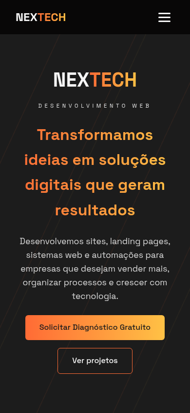

# NEXTECH Web Studio

Site institucional da **NEXTECH**, minha marca de desenvolvimento web. Apresenta os serviços, o processo de trabalho e os projetos, e leva o visitante direto para o WhatsApp para pedir orçamento.

🔗 **Site no ar:** https://nextechwebstudio.netlify.app

<p align="center">
  
  &nbsp;
  
</p>

## Funcionalidades

- **Layout responsivo**: grid de cards que se adapta a qualquer largura de tela, com breakpoint em 768px
- **Menu hambúrguer no mobile**: abre e fecha via JavaScript e fecha sozinho ao clicar em um link
- **Navegação por âncoras** entre as seções, com cabeçalho fixo
- **Contato direto pelo WhatsApp**: botões com mensagem pré-preenchida
- **Identidade visual própria**: paleta laranja e carvão, textos com gradiente e fundo com linhas diagonais feitas só com CSS

## Tecnologias

- HTML5 semântico
- CSS3: variáveis (custom properties), Grid, Flexbox, `clamp()` para tipografia fluida e media queries
- JavaScript puro, sem frameworks nem bibliotecas
- Google Fonts: Space Grotesk e JetBrains Mono
- Deploy na Netlify

## Estrutura

```
├── index.html   # estrutura e conteúdo das seções
├── index.css    # estilos, tema e responsividade
├── index.js     # menu mobile
└── docs/        # imagens deste README
```

## Como rodar localmente

Não tem build nem dependências. Basta clonar e abrir o `index.html` no navegador (ou usar a extensão Live Server do VS Code):

```bash
git clone https://github.com/joao-marcos-tech/nextech-site.git
cd nextech-site
```

---

Feito por [João Marcos](https://github.com/joao-marcos-tech) · NEXTECH Web Studio
